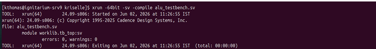
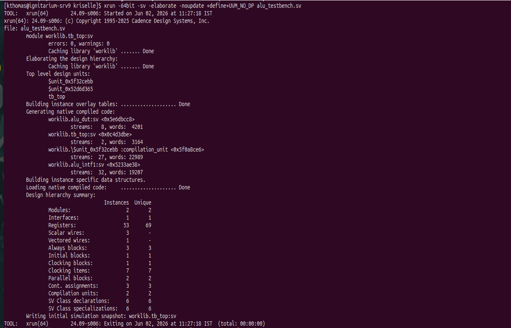
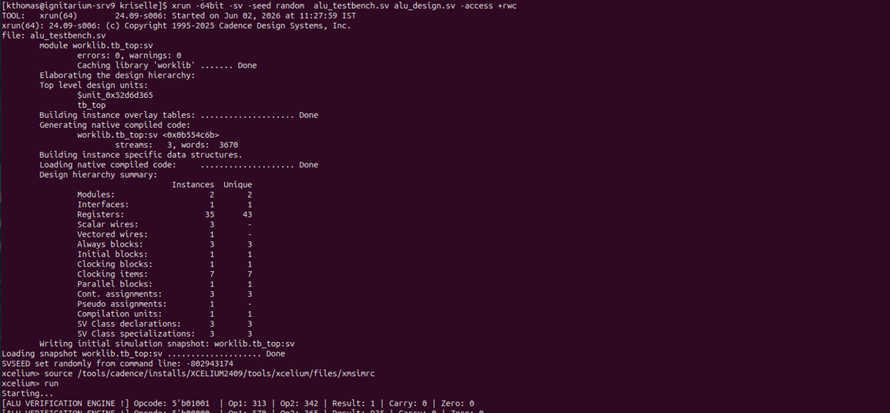
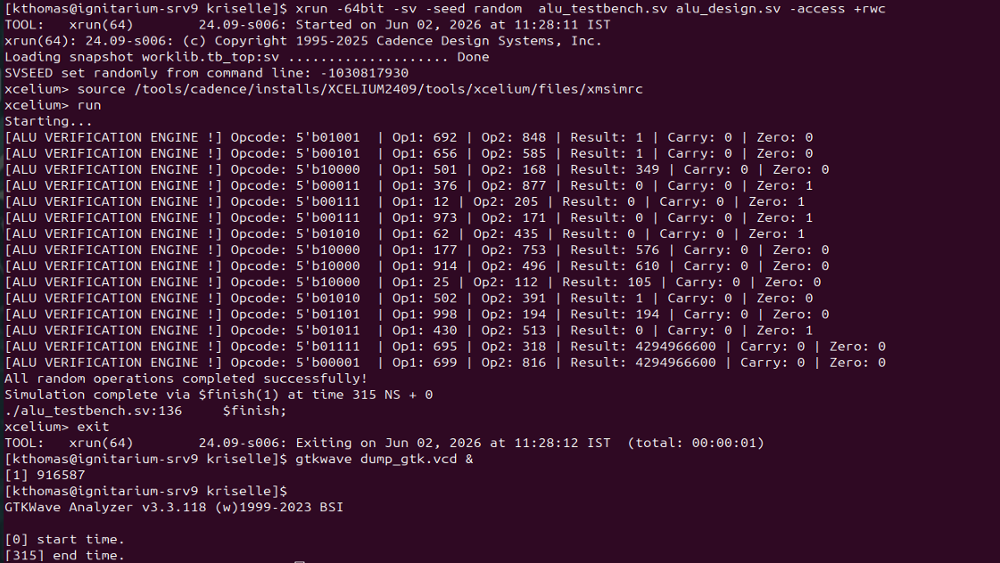
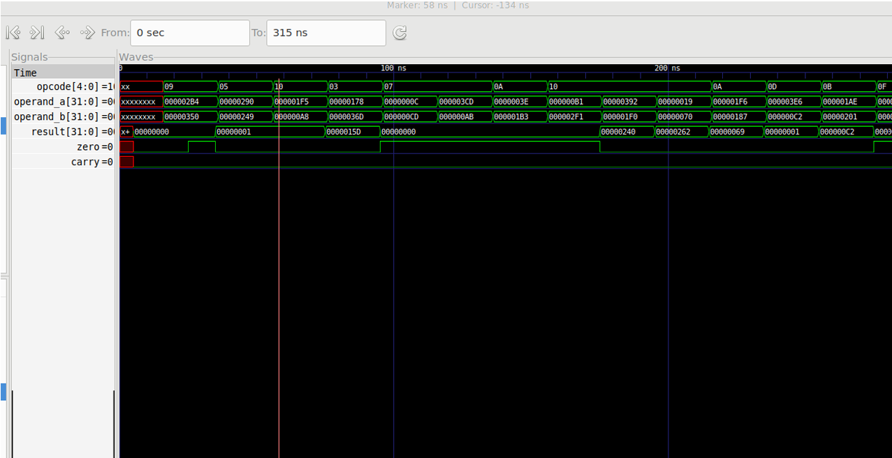
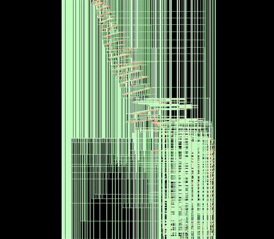

# 32-bit ALU Design and Verification

A 32-bit Arithmetic Logic Unit (ALU) designed using **SystemVerilog**, with a class-based testbench for functional simulation and verification.

This project was developed as part of my **one-month VLSI internship at Neurealm**, where I worked on digital design and verification concepts.

## Overview

The ALU performs arithmetic, logical, comparison, shift, and bitwise operations on two 32-bit input operands. The operation to be performed is selected using a 5-bit opcode.

The design uses combinational logic to calculate the operation result, followed by sequential logic to register the result and status flags on the rising edge of the clock.

## Features

- 32-bit input operands and 32-bit output result.
- 5-bit opcode-based operation selection.
- Arithmetic operations:
  - Addition
  - Subtraction
  - Multiplication
  - Division
- Logical operations:
  - Logical AND
  - Logical OR
  - Logical XOR
  - Logical NOT
- Comparison operations:
  - Equality
  - Less than
  - Greater than
- Shift operations:
  - Logical left shift
  - Logical right shift
- Bitwise operations:
  - Bitwise AND
  - Bitwise OR
  - Bitwise NOT
  - Bitwise XOR
- Status flags:
  - **Carry:** Carry-out for addition and borrow indication for subtraction.
  - **Zero:** Indicates whether the calculated result is zero.
- Active-high asynchronous reset.

## Opcode Reference

| Opcode | Operation |
|---|---|
| `00000` | Addition |
| `00001` | Subtraction |
| `00010` | Multiplication |
| `00011` | Division |
| `00100` | Logical AND |
| `00101` | Logical OR |
| `00110` | Logical XOR |
| `00111` | Logical NOT |
| `01000` | Equality |
| `01001` | Less Than |
| `01010` | Greater Than |
| `01011` | Logical Left Shift |
| `01100` | Logical Right Shift |
| `01101` | Bitwise AND |
| `01110` | Bitwise OR |
| `01111` | Bitwise NOT |
| `10000` | Bitwise XOR |

## Design Architecture

The design consists of two main sections:

### 1. ALU Design (`alu_design.sv`)

The design file contains:

- **Interface (`alu_intf1`):** Connects the ALU design and testbench through shared signals and a clocking block.
- **ALU DUT (`alu_dut`):** Implements the arithmetic, logical, comparison, shift, and bitwise operations.
- **Combinational Logic:** Decodes the opcode and calculates the corresponding result and status flags.
- **Sequential Logic:** Registers the result, carry flag, and zero flag using a clock-triggered process.

### 2. Testbench (`alu_testbench.sv`)

The testbench uses a class-based, constrained-random verification approach.

Its main components are:

- **Transaction Class:** Defines the randomized opcode and input operands, along with fields for the output result and status flags.
- **Driver Class:** Applies the generated transactions to the ALU through the interface.
- **Generator Class:** Creates randomized transactions and passes them to the driver.
- **Top-Level Testbench (`tb_top`):** Generates the clock, applies reset, instantiates the DUT, and starts the verification process.

## Verification Approach

The testbench generates **15 randomized transactions** to exercise the ALU operations.

The randomization constraints ensure that:

- Valid opcodes are selected from the supported operation range.
- Input operands are restricted to the range 0–1000, with operand A restricted to 1–1000.
- Division transactions use a non-zero divisor to avoid division-by-zero cases.

The testbench observes and displays the resulting output and status flags for each transaction.

## Repository Structure

```text
ALU-Design-and-Verification/
│
├── alu_design.sv
│   └── ALU interface and design implementation
│
├── alu_testbench.sv
│   └── Transaction, driver, generator and top-level testbench
│
└── README.md
    └── Project documentation
```

## Tools and Technologies

- **Hardware Description Language:** SystemVerilog
- **Simulation:** Cadence Xcelium
- **Concepts:** Digital Design, ALU Architecture, Sequential and Combinational Logic, Constrained-Random Verification

## Simulation and Synthesis Results

### 1. Design Compilation

The ALU design and testbench were compiled using Cadence Xcelium with zero errors and zero warnings.



### 2. Design Elaboration

The design hierarchy was successfully elaborated, confirming the structural setup of the ALU and testbench.



### 3. Simulation Run

The ALU design was simulated using the SystemVerilog testbench, with randomized transactions applied to exercise the supported operations.



### 4. Testbench Output

The simulator console displays the generated transactions, input operands, operation codes, results, and status flags.



### 5. Waveform Analysis

The simulation waveform was examined using GTKWave to observe the input signals, opcode, registered output, and status flags over time.



### 6. Logic Synthesis

The RTL design was processed using Cadence Genus to generate the synthesized design representation.



## Learning Outcomes

Through this project, I gained practical experience in:

- Designing a 32-bit ALU using SystemVerilog.
- Implementing arithmetic and logical operations using opcode decoding.
- Understanding combinational and sequential design methodologies.
- Developing class-based testbenches.
- Applying constrained-random stimulus generation.
- Working with hardware simulation and verification tools.

---

**Project developed during a one-month VLSI internship at Neurealm.**
